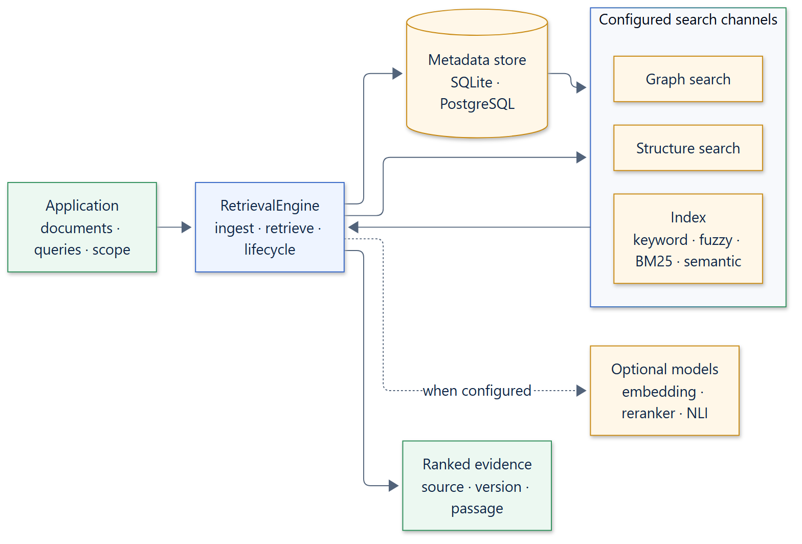

# Architecture

These pages explain RetrievalLoom's public behavior and deployment guarantees.
For setup and everyday use, start with the
[User guide](../guide/index.md).

| Page | Covers |
| --- | --- |
| [Engine and components](engine.md) | Engine lifecycle, defaults and component ownership |
| [Metadata store](storage.md) | SQLite, PostgreSQL, migrations and custom stores |
| [Index lifecycle](lifecycle.md) | Readiness, updates, rebuilds, failures and erasure |
| [Retrieval execution](retrieval.md) | Search stages, results, warnings and isolation |
| [Concurrency and isolation](concurrency.md) | Async execution, resource limits and multi-engine use |

{ .diagram }

## Design principles

- **Async API.** Public operations are coroutines. Blocking component work is
  offloaded so it does not block the application's event loop.
- **Explicit extension points.** Replaceable components implement the public
  abstract base classes and can be checked with the contract kits.
- **Durable source of truth.** The metadata store retains documents and
  lifecycle state; search indexes can be rebuilt from it.
- **Scope isolation.** Operations and evidence are checked against the
  requested scope. Cross-scope evidence raises an error.
- **Visible degradation.** Partial results include warnings that identify
  incomplete or unavailable methods.

## Public integration surface

Applications configure the engine with `EngineConfig`, provide components
through `Components`, and supply shared resources through `EngineResources`.
The [API reference](../api/index.md) documents the supported models,
configuration, component contracts and result types.
