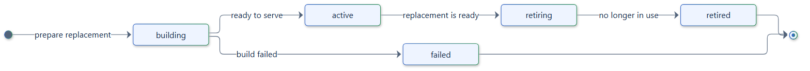
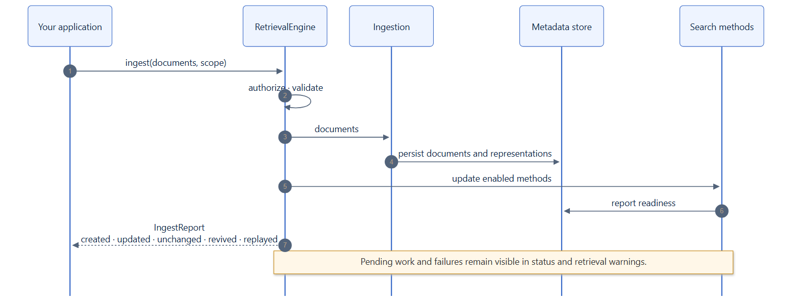

# Index lifecycle

The lifecycle keeps each enabled search method aligned with the documents in
the metadata store. It supports incremental updates, rebuilding after
configuration changes, recovery from backend failures and explicit erasure.

## Index readiness

Each search method maintains its own searchable state for a scope. A method
may be ready, waiting for indexing, or unavailable after a failure. The
`status()` report summarizes readiness; retrieval results include warnings
when a planned method cannot return complete results.

For a rebuild, RetrievalLoom prepares a replacement index and switches
searches to it only after it is ready. This prevents a query from seeing a
half-built replacement. Existing queries can finish using the index they
started with.

{ .diagram }

## Keeping indexes current

Ingestion stores validated documents and their representations before
indexing. By default, `ingest()` waits for the configured indexing work, up
to its wait timeout. The background lifecycle can continue work that remains
pending. Set `index_wait` and background lifecycle options to match the
application's latency and availability requirements.

Routine document changes are applied incrementally when supported by the
configured backend. A first build, an explicit `rebuild()`, or a change to an
index's dependencies may require a new build.

{ .diagram }

Use `backfill()` to index documents a method does not yet cover. Use
`rebuild()` when a method needs a fresh index, for example after changing an
embedding model. Both return a task reference that can be passed to
`wait_for()`. See [Backfill and rebuild](../guide/how-to/backfill-and-rebuild.md).

## Failure recovery

Retryable backend failures can be retried automatically with the configured
backoff. A non-retryable failure remains visible in status and retrieval
warnings until its cause is corrected and the affected documents are
backfilled.

Do not treat a partial result as complete. Check `result.status` and
`result.warnings`, and surface the missing method or indexing failure to the
caller or operator.

## Channel changes

Channels and methods are configured when an engine is opened. Reopen the
engine with the desired configuration to add or remove a channel. A newly
enabled method can index existing documents; use `backfill()` or wait for the
background lifecycle according to the selected startup and indexing policy.
The [channel combinations example](../examples/channel-combinations.md)
demonstrates changes at startup and later in a document lifecycle.

## Deletion, erasure and retention

`delete()` hides a document from retrieval while retaining its history.
`purge()` physically erases the document and its associated records. Engines
sharing a metadata store receive erasure updates through their lifecycle
processing; retrieval validates results against current metadata in the
meantime.

Retention settings control how long deleted documents, versions and ingestion
events remain. A version referenced by a retained ingestion event is preserved
until that event expires. See
[Deletion, erasure and retention](../guide/concepts/lifecycle.md#deletion-erasure-and-retention)
for the application-facing settings.

## Durable and in-memory indexes

The built-in keyword, fuzzy and sparse indexes are in memory and are rebuilt
from metadata when an engine opens. Persistent vector, graph and structure
backends can be reused across restarts when configured with durable storage.
Each process maintains its own in-memory indexes.

For sizing data and restart measurements, see [Benchmarks](../benchmarks.md).
