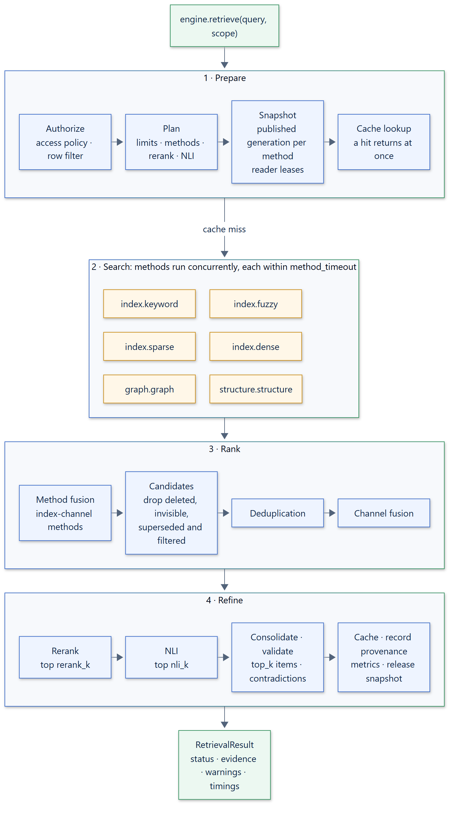

# Retrieval execution

Find the module behind each stage of a search, so you can read its code, replace
it or debug it. This page maps the
[retrieval pipeline](../guide/concepts/retrieval.md) onto modules.

## Modules

| Module | Role |
| --- | --- |
| `engine` | Authorization, the per-tenant request slot, the access policy's row filter. |
| `retrieval.planning` | Validates the request against limits and the tenant policy; decides which methods, reranking and NLI run; builds fusion. |
| `retrieval.snapshot` | Picks the published generation per method, checks fingerprint and coverage, registers readers and leases. |
| `retrieval.pipeline` | `RetrievalPipeline`: runs methods, fusion, candidates, rerank, NLI, consolidation, cache and recording under one deadline. |
| `retrieval.candidates` | Resolves hits to objects and versions; drops deleted, invisible and superseded versions and filtered objects. |
| `evidence.fusion`, `evidence.normalizers` | Fusion strategies on ranknexus and score normalizers. |
| `evidence.dedup` | `IdentityAndHashDeduplicator`. |
| `evidence.rerank` | Rerank stage and `FlashRankReranker`. |
| `evidence.consolidation` | `HierarchicalConsolidator` and NLI summaries. |
| `evidence.validation` | Final evidence validation: provenance integrity and scope isolation, whatever the consolidator. |
| `index.embedding` | `EmbeddingValidator`: count, dimension and finiteness checks on embeddings. |

## Flow of one request

{ .diagram }

After authorization the request also takes a slot from its tenant's
concurrency limit. The snapshot is released when the request ends, whether it
succeeded, failed or was cancelled.

The whole request runs under one deadline (`request_timeout`, or `timeout` in
`RetrievalExecutionConfig`). With `allow_partial_on_deadline=True`, a deadline
reached while methods run returns the finished parts with `timeout_partial`.

## Cache

After planning and taking the snapshot, the pipeline looks up the result cache. The key
covers the request (without `request_id` and `principal`), the effective
filter, the snapshot (generation ids and commit sequence) and the pipeline
configuration. Only `complete` results are stored.

## Scope checks

Every backend call carries the scope and generation id. When a hit returns,
the candidate stage and the final evidence validation check that it belongs to the request scope. A
mismatch raises `TenantIsolationError`; it is never degraded.

## Warnings

Each stage appends `RetrievalWarning`s to the run. The final status is computed
from them: `empty` without evidence, `partial` with any `warning` or `error`
severity, `complete` otherwise. See [Troubleshooting](../guide/troubleshooting.md).
