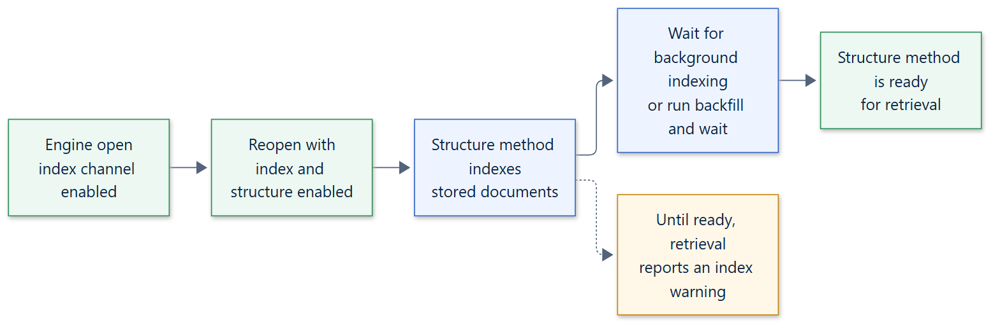

# Channel combinations

Add, remove and re-enable channels on a store that already holds documents, and see
what each step does to your results. Many deployments start with the index channel
alone and add graph or structure search later, once a graph extractor or document
outlines are available, and sometimes switch a channel off for a while. This example
runs that cycle on a small set of operations runbooks, reopening the engine on the same
durable `data_dir` each time:

1. Start with the index channel only and ingest the runbooks.
2. Turn on the structure channel. The engine indexes the existing runbooks for it while
   it opens.
3. Turn on the graph channel with the startup rebuild off, and catch up explicitly with
   `backfill` and `wait_for`.
4. Reopen the store with each of the seven channel combinations, including graph and
   structure without the index, and see which channels answer.
5. Narrow single requests to one channel without reopening the engine.
6. Switch the graph off, delete a runbook, and switch the graph back on.

For the rules behind it, see
[Change channels on an existing store](../guide/concepts/channels.md#change-channels-on-an-existing-store).

## How it works

{ .diagram }

- **Channels are set when the engine opens.** A running engine has no API to switch a
  channel on or off. To change channels, close the engine and open it again with a new
  `ChannelsConfig` on the same `data_dir`, or on the same metadata store and backends.
  `RetrievalExecutionConfig` can still narrow a single request to some of the enabled
  channels. Step 5 uses it to ask the same question of each channel on its own.
- **Enabling a channel covers existing documents.** The new graph and structure units
  start with `pending` coverage for every document already in the store. The graph
  extractor runs on documents that were ingested while the graph was off. Documents
  without a `StructureRepresentation` become `not_applicable` for the structure channel.
- **Until a channel catches up, results are incomplete.** With `auto_rebuild_ephemeral=False` nothing is built at startup.
  Until a backfill builds the units, retrieval is `partial`, or `empty` when no channel
  can answer, and each missing method is listed in an `index_missing` warning.
  `engine.backfill()` followed by `engine.wait_for()` closes the window. With the
  default startup rebuild (`auto_rebuild_ephemeral=True`) the units are built during
  `initialize`, either in the foreground or, with `background=True` and
  `wait_for_rebuild=True`, before the engine opens.
- **Disabling a channel keeps its history.** A disabled channel is never queried and is not maintained.
  Its coverage rows stay in the metadata store and still appear in `status()`, but they
  do not block automatic purges.
- **Re-enabling a channel applies what it missed.** Documents deleted, purged or updated while a channel was
  off are reconciled when it comes back:
    - The graph retracts the contributions of deleted documents.
    - Durable units apply the purges they missed, or rebuild from metadata when the
      purge log no longer reaches back far enough.
    - Updated documents are re-derived and re-indexed.

  In step 6, `vpn-access` is deleted while the graph is off. Its entities are gone once
  the graph is back.

## Requirements

The `graph` and `structure` extras: `pip install "retrievalloom[graph,structure]"`. The
example uses no embedding model, so the dense method is turned off.

## Run

```bash
python examples/channel_combinations.py
```

## Source

<!-- fmt: off -->
```python title="examples/channel_combinations.py"
--8<-- "examples/channel_combinations.py"
```
<!-- fmt: on -->

## Expected output

```text
1. index only
   complete ['db-failover[index]']
2. structure turned on later (caught up while the engine opens)
   index.keyword: {'ready': 3}
   structure.structure: {'ready': 3}
   complete ['db-failover[structure]', 'db-failover[index]', 'db-failover[structure]']
3. graph turned on as well, caught up by an explicit backfill
   before backfill:
   partial ['db-failover[structure]', 'db-failover[structure]'] warnings=['index_missing:fuzzy', 'index_missing:graph', 'index_missing:keyword', 'index_missing:sparse']
   after backfill:
   graph.graph: {'ready': 3}
   complete ['db-failover[graph]', 'db-failover[structure]', 'db-failover[index]', 'db-failover[graph]']
4. every combination on the same store
   index                      answered by ['index']
   structure                  answered by ['structure']
   graph                      answered by ['graph']
   index + structure          answered by ['index', 'structure']
   index + graph              answered by ['graph', 'index']
   structure + graph          answered by ['graph', 'structure']
   index + structure + graph  answered by ['graph', 'index', 'structure']
   nothing enabled              rejected
5. one channel per request: 'Who works on Postgres?'
   index:
   complete ["db-failover[index] 'Team Harbor watches Postgres'"]
   structure:
   complete ["db-failover[structure] 'Team Harbor watches Postgres'", "db-failover[structure] 'Team Harbor promotes the Pos'"]
   graph:
   complete ["db-failover[graph] 'Postgres'", "db-failover[graph] 'Team Harbor PROMOTES_THE Pos'", "db-failover[graph] 'Frankfurt Region'", "db-failover[graph] 'Postgres REPLICA_IN Frankfur'"]
6. graph off; vpn-access deleted meanwhile
   complete ['cache-flush[index+structure]', 'db-failover[structure]', 'db-failover[index]', 'db-failover[structure]']
   graph on again (the startup round catches up)
   graph.graph: {'deleted': 1, 'ready': 2}
   complete ['cache-flush[structure]', 'cache-flush[graph]', 'db-failover[structure]', 'cache-flush[graph]']
```

Step 2 needs no extra call: the startup round catches the new channel up before the
engine opens. In step 3 the startup rebuild is off, so nothing is built yet, including
the in-memory keyword, fuzzy and sparse indexes, and the result is `partial`. The
warnings show that the result is missing data, not that nothing matched. After the
backfill all three channels answer. In step 4 each combination is answered by exactly
the channels it enables. In step 6 the re-enabled graph serves no entity from the
deleted runbook, and its coverage counts the runbook as `deleted`.

A configuration with no channel enabled, or with only the index channel enabled and all
of its methods off, is rejected when `ChannelsConfig` is validated, as the last line of
step 4 shows. An engine whose enabled methods all lack a backend, for example dense
alone without an embedding model, raises `ConfigurationError` when it opens.