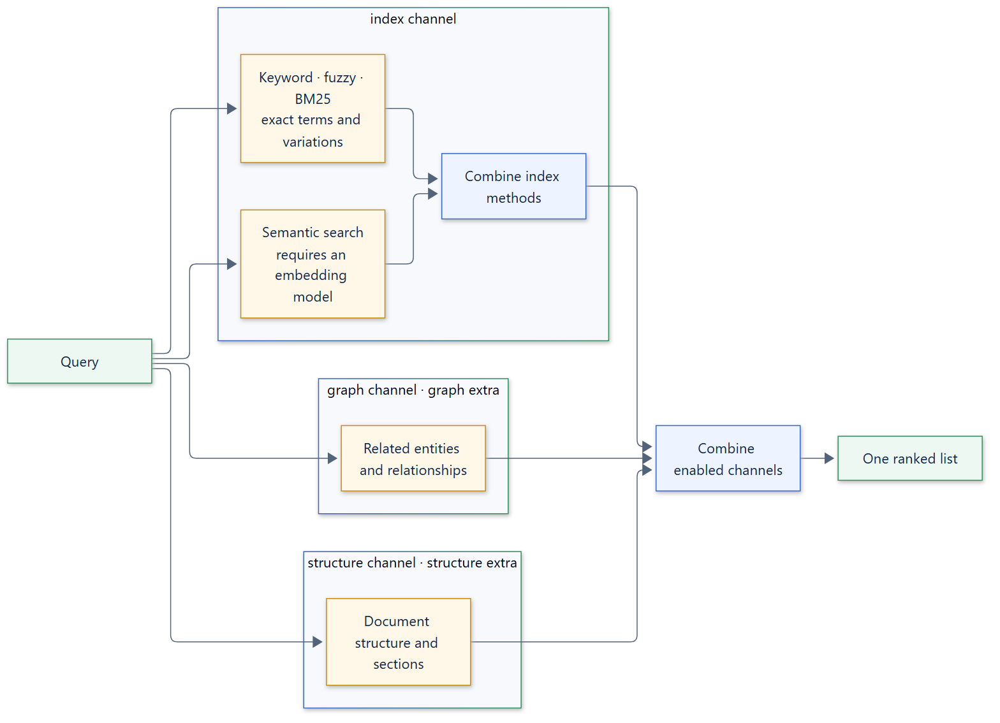
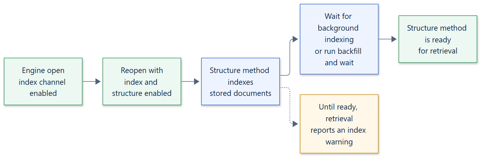

# Channels and methods

Choose search methods based on how users phrase questions and what the
documents contain. A request searches the enabled methods and combines their
rankings into one result set.

| User query | Method |
| --- | --- |
| Product names, error codes, part numbers | `index.keyword` |
| Misspelled or partial terms | `index.fuzzy` |
| Natural-language questions with matching terms | `index.sparse` (BM25) |
| Paraphrases with few or no shared words | `index.dense` |
| Questions about related entities | `graph.graph` |
| Section names in long, structured documents | `structure.structure` |

The index channel provides keyword, fuzzy, sparse and dense methods. Graph and
structure are optional channels. Dense search needs an embedding model;
graph and structure require their corresponding extras.

{ .diagram }

## Index methods

### Keyword

Keyword search finds configured terms such as product names and error codes.
By default, terms come from the `keywords` document metadata field. Without
dictionary entries, this method returns no matches.

To use other metadata fields or define fixed terms, configure the keyword
dictionary:

```python
from retrievalloom import Components
from retrievalloom.contracts.models import KeywordEntry
from retrievalloom.index.text import MetadataKeywordDictionary

components = Components(
    keyword_dictionary=MetadataKeywordDictionary(
        fields=("keywords", "product"),
        static_entries=[KeywordEntry(canonical="WPA3", aliases=("WPA 3",))],
    )
)
```

### Fuzzy

Fuzzy search can match terms when users misspell or abbreviate them. Tune the
maximum n-gram length, minimum token length, corpus vocabulary and score cutoff
in `FuzzyConfig`. Disable it when typo tolerance is not useful for the
application.

### Sparse

Sparse search ranks passages using BM25 term relevance. It uses tokens
produced by the configured tokenizer; the default tokenizer normalizes text
and splits it into word tokens.

### Dense

Dense search finds passages by semantic similarity and is useful for
paraphrases. It requires an embedding model and vector store. The default
vector store is Qdrant; configure an embedding model through `Components`.
See [Use your own embedding model](../how-to/embedding-model.md) and
[Qdrant](../../integrations/qdrant.md).

## Graph channel

Graph search answers questions about related entities and relationships.
Graph data can come from `GraphRepresentation` inputs or a custom
`GraphExtractorABC`. Configure the traversal depth and graph backend for the
application's data. Install the `graph` extra to use the built-in backend.

## Structure channel

Structure search finds sections by their titles and content. It uses
`StructureRepresentation` inputs. Enable `StructureChannelConfig` and install
the `structure` extra to use the built-in backend.

## Combining results

Method fusion combines the methods in the index channel. Channel fusion then
combines the enabled channels. Both stages use reciprocal rank fusion by
default; configure them independently with `RetrievalConfig.method_fusion`
and `channel_fusion`. Per-method and per-channel weights are available when
using weighted fusion. See [Retrieval pipeline](retrieval.md#fusion).

## Change channels on an existing store

Channels are fixed while an engine is open. To add or remove a channel, close
the engine and reopen it with a new `ChannelsConfig` against the same
`data_dir`, metadata store and durable backends.

{ .diagram }

When you enable a channel, it indexes existing documents. Graph extraction is
also run for documents ingested while graph search was disabled. Documents
without a structure representation are not applicable to structure search.
Documents changed or deleted while a channel was disabled are reconciled
when it is enabled again.

Until indexing completes, retrieval results include `index_missing` or
coverage warnings. To wait for readiness, configure startup rebuild behavior
with `LifecycleConfig.wait_for_rebuild`, or call `backfill()` and `wait_for()`
after opening. The
[channel combinations example](../../examples/channel-combinations.md)
demonstrates all combinations and transitions.

Disabling a channel stops it from being searched. `RetrievalExecutionConfig`
can also narrow one request to a subset of the enabled channels without
reopening the engine.
