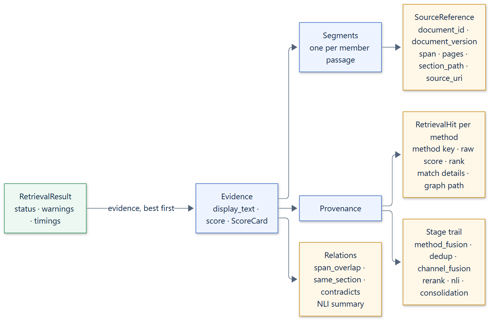

# Evidence and provenance

Cite every answer and show users where it came from. `retrieve` returns a
`RetrievalResult` whose `evidence` tuple holds the results, best first. Each
`Evidence` item carries its text, its score, the exact document version and
location it came from, and a record of how it was found.

{ .diagram }

## Evidence

An evidence item groups matching passages that belong together, so you get
one coherent result instead of several fragments of the same section. The
default `HierarchicalConsolidator` merges candidates of the same document
version and representation that:

- overlap in span (intersection over union of at least `span_iou_threshold`),
- are parent and child in a chunk or structure tree (`group_structural=True`),
- share a section path (`group_structural=True`),
- are adjacent chunks (`merge_adjacent=True`).

Two relations link items without merging them. `semantically_similar` needs
`semantic_relations=True` and an embedding model. `contradicts` links an
item judged *entailment* to one judged *contradiction* for the same query or
claim by the NLI model.

| Field | Meaning |
| --- | --- |
| `evidence_id` | Stable id of the item. |
| `segments` | One segment per member candidate: `candidate_id`, `object_id`, `text`, `sources`. |
| `display_text` | Member texts in reading order, joined by blank lines. |
| `score` | Final score of the best member. |
| `scores` | `ScoreCard` of the best member: `normalized` per method, `method_fusion`, `channel_fusion`, `rerank`, `final`. |
| `sources` | Every `SourceReference` of the members. |
| `relations` | Relations between members (`identical`, `span_overlap`, `same_section`, `parent_child`, `complementary`, ...). |
| `linked_evidence_ids` | Other items related to this one, for example by a contradiction. |
| `nli_summary` | Counts of entailment, contradiction and neutral judgments. |
| `completeness` | Members without a span, from a superseded version, or with partial coverage. |
| `provenance` | Sources, all method hits and the stage trail. |

## Sources

A `SourceReference` names exactly where a passage came from, so you can link
to it or quote it:

- `scope`, `document_id`, `document_uid`, `document_version`
- `representation_id` and `object_id`
- `span`, `pages`, `lines`, `section_path` when the input carried them
- `source_uri` and `title` from the document's `SourceDescriptor`
- `transformation` from the representation's `TransformationRef`

RetrievalLoom never guesses locations. A chunk without a `span` input has no
span in its source, and its object id appears in `completeness.missing_spans`.

## Provenance

`Evidence.provenance` explains how the item was found, which helps you debug
ranking and audit answers:

- `hits`: every `RetrievalHit` behind the members. Each hit has the method
  (`hit.method.key`, for example `index.sparse`), the backend id, the raw
  score and its semantics, the rank, match details and, for graph hits, the
  traversal path.
- `stage_trail`: one `StageRecord` per stage that ran, in order: methods
  (`method:index.keyword`, ...), `method_fusion`, `dedup`, `channel_fusion`,
  `rerank`, `nli`, `consolidation`. Each record has the component id, version
  and configuration fingerprint.

A stage that was skipped or degraded is absent from the trail and is reported
as a warning.

```python
for item in result.evidence:
    for source in item.sources:
        print(source.document_id, source.document_version, source.span, source.section_path)
    print([hit.method.key for hit in item.provenance.hits])
    print([stage.stage for stage in item.provenance.stage_trail])
```

## Record provenance in an audit trail

After each retrieval, `Components.provenance_recorder` receives the request
and the result. The default records nothing, unless you pass an agxai runtime
as `EngineResources(xai_runtime=...)`. The
[agxai integration](../../integrations/agxai.md) then records retrievals in the
active agxai run. A recorder failure adds a
`provenance_recording_failed` warning, or raises `ProvenanceError` when
`fail_on_recording_error=True`.

## Next steps

- Learn how indexes stay current in [Generations and coverage](lifecycle.md).
- Record searches in an audit trail with the [agxai integration](../../integrations/agxai.md).
