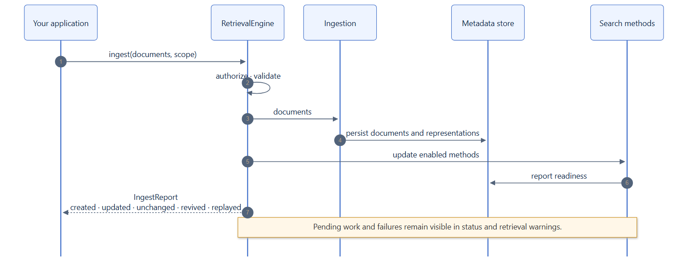

# Generations and coverage

RetrievalLoom keeps configured search methods aligned with documents as they
are added, changed, deleted and erased. Indexing can continue in the
background, and retrieval results identify when a method is not ready.

## Readiness

`engine.status(scope=...)` reports readiness for each configured method.
Documents may be pending, ready, failed, deleted or not applicable to a
method. Retrieval reports incomplete coverage with warnings rather than
presenting it as a complete search.

When rebuilding an index, RetrievalLoom prepares the replacement before
switching new searches to it. A search uses one consistent index state for
its duration.

{ .diagram }

## Indexing changes

Ingestion persists validated documents before indexing them. By default,
`ingest()` waits for indexing work, subject to the configured wait timeout.
The background lifecycle can complete work that remains pending.

Use `backfill()` to index existing documents that a method does not cover. Use
`rebuild()` to create a fresh index, for example after changing an embedding
model. Both operations return a task reference that can be passed to
`wait_for()`.

{ .diagram }

Configure `index_wait`, `background`, `wait_for_rebuild` and the relevant
timeouts to balance startup time, write latency and search readiness. See
[Backfill and rebuild](../how-to/backfill-and-rebuild.md).

## Failures

Retryable backend failures can be retried automatically after
`LifecycleConfig.retry_failed_after`, with delay bounded by
`retry_failed_max_delay`. Set `retry_failed_after=None` to disable these
retries.

Non-retryable failures remain visible in status and retrieval warnings.
Correct the cause, then call `backfill()` to retry the affected documents.
Always inspect `result.status` and `result.warnings` before using retrieved
evidence.

## Channel changes

Channels and methods are selected when the engine opens. To change them,
reopen the engine with the desired configuration. Newly enabled methods can
index stored documents. The
[channel combinations example](../../examples/channel-combinations.md)
shows both startup configuration and later changes in a document lifecycle.

## Deletion, erasure and retention

`delete()` hides a document from retrieval and retains its history.
`purge()` physically erases the document and its associated records.
`LifecycleConfig.purge_after` can erase tombstoned documents automatically
after the configured retention period and once the indexes no longer need
them.

Retention settings also control document versions and ingestion events:

- `max_versions` limits retained version history per document.
- `event_retention` controls how long ingestion events are retained.
- A version referenced by a retained ingestion event remains available until
  that event expires.
- `purge_log_retention` bounds how long erasure updates are retained for
  engines that share a metadata store.

Set a retention setting to `None` to disable that retention policy. Choose
values to meet the application's audit and erasure requirements. See
[Security and retention](../../security.md#erasure-and-retention).

## In-memory and durable indexes

The built-in keyword, fuzzy and sparse indexes are in memory. Each process
rebuilds them from the metadata store when it opens. Vector, graph and
structure indexes can use persistent backends and be reused across restarts.

| Backend | Persists across restarts when |
| --- | --- |
| Keyword, fuzzy and sparse | Never; these built-in indexes are in memory. |
| Qdrant vector store | Configured with a persistent path, server URL or client. |
| Graph store | Configured with a persistent path or shared server backend. |
| Structure engine | Configured with a persistent directory. |

For measured memory use and startup time, see [Benchmarks](../../benchmarks.md).
