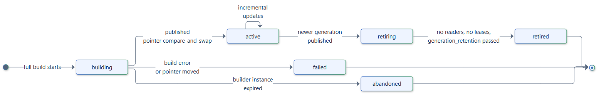

# Generations and coverage

Edit, delete and re-index documents while your application keeps serving
searches. RetrievalLoom stores every document in the metadata store and builds
each search index from it, so an index can always be rebuilt. This page
explains how indexes follow your changes, how a search avoids half-built
indexes, and how deleted data is erased.

## Index units

Each enabled search method keeps its own index, called an *index unit*, named `<channel>.<method>` (for
example `index.dense`). A unit has a backend and a *dependency fingerprint*:
a digest of the backend's identity and configuration and of the components it
depends on (tokenizer, keyword dictionary, embedding model). Changing any of
them changes the fingerprint.

## Generations

A *generation* is one complete build of one index for one scope. Building a
new generation next to the current one lets you change models or rebuild an
index without interrupting searches. Its state moves through:

{ .diagram }

Each scope and unit has a *pointer* to its active generation. A new generation
is published by moving the pointer with a compare-and-swap in one metadata
transaction, together with the document visibility and coverage updates.
Searches see the old generation or the new one, never a mix.

The previous generation becomes `retiring`. It is dropped once nobody reads it
and `generation_retention` seconds have passed. See
[Reader leases](#reader-leases).

## Coverage

Coverage records, for each document and index, whether the document's current
version is searchable yet:

| State | Meaning |
| --- | --- |
| `pending` | The current version still has to be indexed. |
| `ready` | The current version is in the active generation. |
| `failed` | Indexing failed `max_attempts` times. Retried automatically when the error was retryable (see [Recover from failures](#recover-from-failures)); otherwise reset by `backfill`. |
| `deleted` | The document was deleted and removed from the index. |
| `not_applicable` | The document has nothing for this unit, for example no `structure` representation. |
| `processing`, `stale` | Defined in `CoverageState` and counted as not ready, but the current indexer does not set them. |

`engine.status(scope=...)` returns the counts per unit. Retrieval reports gaps
as warnings (see [Retrieval warnings](#what-retrieval-sees)).

## How changes reach the indexes

Indexing runs in *rounds*. Each round compares every unit with the metadata
store and does one of two things:

{ .diagram }

- **Incremental update.** If the unit already has a generation with the
  current fingerprint and its backend can be changed in place, the new and
  changed documents are written to the active generation and the objects of
  their older versions are removed. Deleted documents are removed. The
  keyword, fuzzy and sparse indexes, the Qdrant vector store and the
  TreeSearch structure engine work this way, so an ingest batch costs time
  proportional to the batch, not to the corpus.
- **Full build.** Otherwise a new generation is built from the metadata store
  and published. This happens for the first build, after a fingerprint change,
  after `rebuild`, when the keyword dictionary changed (keyword and fuzzy
  units), for every change on backends that cannot be changed in place, and
  on the graph channel (graph aggregates depend on many documents).

A document version becomes visible to a unit only when it is indexed there.
Until then, hits of its previous version are dropped (a
`stale_document_version` info warning), unless `allow_stale_versions=True`. Use `engine.rebuild(...)` to force a new
generation.

## Who runs the rounds

- `ingest` and `delete` run one round for the scope and wait for it when
  `IngestionConfig.index_wait="all"` (the default), up to
  `index_wait_timeout`.
- With `LifecycleConfig.background=True` (the default) a scheduler runs a
  maintenance and indexing round every `poll_interval` seconds.
- `engine.run_lifecycle_once(scope)` runs one round on demand, for
  deployments that schedule work themselves.
- `engine.wait_for(task)` runs rounds itself when there is no background
  scheduler.

Rounds run through [refresh-engine](../../integrations/refresh-engine.md),
which retries failed units and limits concurrency (`max_concurrency`).

## Recover from failures

A backend outage does not leave documents unindexed for good. When a document
fails to index `max_attempts` times, its coverage becomes `failed` and the
error is stored with it. Each maintenance round (every background round, and
every `run_lifecycle_once`) then decides what happens next:

- **Retryable errors**, such as `BackendUnavailableError` or a timeout, are
  queued again after `LifecycleConfig.retry_failed_after` seconds (30 by
  default). Each further failure doubles the delay, up to
  `retry_failed_max_delay` (900 seconds). After a vector-store outage, dense
  coverage returns to `ready` on its own once the store is back.
- **Non-retryable errors**, such as an embedding model that returns invalid
  vectors, stay `failed`. Fix the cause, then call `backfill`, which resets
  the coverage and its attempt counter.

Set `retry_failed_after=None` to turn automatic retries off.

## Tasks

`backfill` and `rebuild` queue durable lifecycle tasks and return a
`LifecycleTaskRef`. Wait for one with `wait_for`:

```python
ref = await engine.rebuild(scope=scope, channel="index", method="dense")
result = await engine.wait_for(ref, timeout=300)
print(result.state.value)  # "succeeded"
```

- `backfill(scope=..., channels=..., methods=...)` indexes every document the
  selected units do not cover yet, and resets `failed` coverage to `pending`.
- `rebuild(scope=..., channel=..., method=...)` builds a new generation of the
  unit and switches to it atomically.

See [Backfill and rebuild](../how-to/backfill-and-rebuild.md).

## Deletion, erasure and retention

Deleting a document hides it at once; erasing it removes every trace. `delete`
makes a document a *tombstone*: it is hidden from retrieval at once,
its objects and graph contributions are retracted, and the next rounds remove
its objects from the indexes and mark its coverage `deleted`. The metadata
store still holds its versions, representations, events and objects.

{ .diagram }

`purge(ids, scope=...)` erases documents physically. It tombstones them first
when needed, then works in batches of up to 500 documents:

1. plans the whole batch in one read transaction;
2. removes the batch's objects, and graph aggregates no other document
   supports, from every building, active and retiring generation of this
   engine's units, with one removal call per generation;
3. queues a `rebuild` of the graph unit when the active graph generation still
   includes a purged document (the task ids are in `PurgeReport.task_ids`);
4. deletes every metadata row of the batch's documents in one transaction: the
   documents, their versions, representations, ingestion events, objects,
   contributions, lineage edges, visibility windows and coverage. The same
   transaction appends one entry per document to the purge log.

A document changed by a concurrent write between steps 1 and 4 is left out of
the transaction and planned again; the others are deleted. If a backend fails
in step 2, nothing of the batch is deleted from the metadata store and the
call raises; retry it. Purging is idempotent: unknown and already purged ids
are reported in `not_found`. The same access policy action as `delete`
authorizes it.

Other engines on the same store read the purge log at the start of each
lifecycle round and remove the purged objects from their in-memory indexes:
within about `poll_interval` with the background scheduler, or at the next
`ingest`, `delete`, `purge`, `wait_for` or `run_lifecycle_once` call with
`background=False`. An engine that missed entries because they were pruned
(after `purge_log_retention`, default 1 day) rebuilds its in-memory indexes
of the scope instead. Retrieval never returns a purged document in the
meantime, because evidence is read from the metadata store.

The maintenance round also erases tombstones on its own once they are older
than `purge_after` (default 7 days) and every unit has marked them `deleted`.
It prunes history too:

- **Versions.** Only the newest `max_versions` (default 10) version-history
  entries of a document are kept, with their representations. A version is
  never pruned while it is the current version, has live objects or supports
  a live graph aggregate, is visible to a unit, is indexed by an active or
  retiring generation, or is the `version_after` of a retained ingestion
  event. Events are pruned first, so an expired event releases its version in
  the same round.
- **Events.** Committed and failed ingestion events older than
  `event_retention` (default 90 days) are deleted. A redelivery of an event
  older than that is processed again instead of being reported as `replayed`.
- **Purge log.** Entries older than `purge_log_retention` (default 1 day) are
  deleted; the newest entry of each scope is always kept.

Set any of the first three to `None` to disable it. With the background scheduler,
this housekeeping runs at most every five minutes; `run_lifecycle_once` always
runs it.

## Ephemeral and durable backends

A backend is *durable* when its data outlives the engine process. Durable
backends survive a restart; ephemeral (in-memory) ones are rebuilt from the
metadata store:

| Backend | Durable when |
| --- | --- |
| `AhoCorasickKeywordIndex`, `RapidFuzzIndex`, `BM25sIndex` | Never (in memory) |
| `QdrantVectorStore` | `path=`, `url=` or `client=` is set |
| `LadybugGraphStore` | `path` is set |
| `TreeSearchStructureEngine` | `directory` is set |

Ephemeral generations belong to one engine instance. Their metadata rows
(coverage, visibility, pointers, generations) carry the instance id and are
purged when the engine closes or its registration expires
(`instance_ttl`). With `auto_rebuild_ephemeral=True`, a new engine rebuilds
them from the metadata store at startup: before the engine opens when
`background=False` or `wait_for_rebuild=True` (bounded by `rebuild_timeout`),
otherwise in the first background round (see
[Keep data on disk](../how-to/durable-storage.md)).

Durable generations are shared by every engine that uses the same metadata
store and the same backend location.

## Reader leases

A search never loses its index halfway through: retirement never drops a
generation that a request is reading.

- **In-process readers.** Every retrieval registers as a reader of each
  generation it uses until the request ends. A retiring generation accepts no
  new readers and is not dropped while readers remain.
- **Durable reader leases.** For durable backends shared by several engines on
  one metadata store, each engine also holds a durable reader lease, per
  generation and per engine instance, while it reads. A lease lasts
  `lifecycle.lease_ttl` seconds (default 120). It is renewed when less than
  half of the TTL remains.

Retirement of a generation waits until no *other* engine holds an unexpired
lease. An engine's lease may persist up to `lease_ttl` after its last read,
unless the engine closes: closing deregisters the instance and deletes its
leases. Expired leases are purged by the maintenance round.
`generation_retention` delays dropping further.

Ephemeral backends need no leases: they are per instance.

## What retrieval sees

When the snapshot is taken, each planned method is checked:

| Situation | Warning | Method runs? |
| --- | --- | --- |
| No published generation | `index_missing` | No |
| Generation built with another fingerprint | `stale_coverage` | No |
| Generation is being retired | `stage_skipped` | No |
| Not every active document is `ready` or `not_applicable` | `partial_coverage` | Yes |

All four have `warning` severity, so the result is `partial`.
`RetrievalConfig.missing_index_policy` controls missing indexes: `skip`
(default), `fail` (raise `CoverageError`) or `schedule_backfill` (queue a
backfill task and add a `backfill_scheduled` info warning).

## Next steps

- Keep indexes across restarts with [durable storage](../how-to/durable-storage.md).
- Add a method or change a model with [Backfill and rebuild](../how-to/backfill-and-rebuild.md).
- See how blocking work is scheduled in [Offloading and admission](offloading.md).
