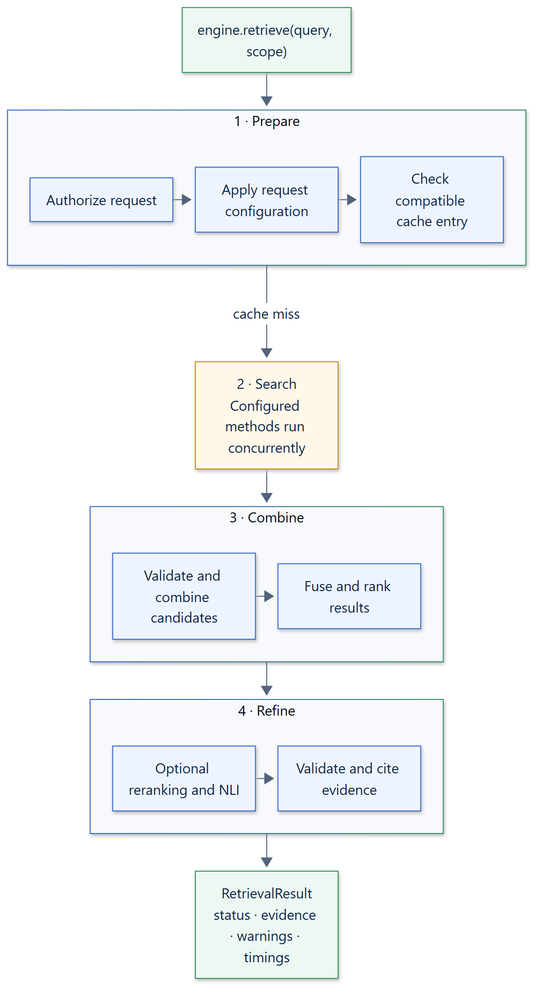

# Retrieval pipeline

Know what happens between a query and its results, so you can tune ranking and
read every warning with confidence. A search runs all enabled methods at the
same time, merges their rankings, optionally reranks the best matches, and
groups them into evidence items. When a method fails or runs out of time, the
search still returns what it found and tells you what was skipped.

## Stages

{ .diagram }

`engine.retrieve(query, scope=...)` runs these stages in order:

1. **Authorize and validate.** The access policy authorizes the call and may
   add a mandatory row filter. Request and tenant settings determine the
   allowed query, filters and result size.
2. **Search.** Enabled methods run concurrently within their method and
   request deadlines. Results are checked against the requested scope and
   effective filters.
3. **Combine and rank.** Method and channel results are fused, and duplicate
   candidates are consolidated.
4. **Refine.** Optional reranking and NLI assess the most relevant passages.
5. **Return evidence.** The engine returns ranked evidence with source
   citations, provenance, status and warnings. A configured recorder receives
   the request and result.

## Fusion

Fusion merges several ranked lists into one. RetrievalLoom uses
[ranknexus](https://pypi.org/project/ranknexus/) at two levels, configured
separately:

- `RetrievalConfig.method_fusion` fuses the methods inside the index channel,
  weighted by `MethodConfig.weight`.
- `RetrievalConfig.channel_fusion` fuses the channels, weighted by the channel
  `weight`.

Both default to Reciprocal Rank Fusion with `k=60`. The supported methods are
`rrf`, `weighted_rrf`, `weighted_score`, `combsum` and `combmnz`. Score-based
methods normalize scores first with `minmax`, `zscore`, `rank` or `sigmoid`.
Hits without a finite score fall back to rank normalization. You can change the
fusion method per request:

```python
config = RetrievalExecutionConfig(method_fusion="weighted_rrf", channel_fusion="rrf")
```

To replace fusion entirely, pass a `FusionABC` as `Components.method_fusion`
or `Components.channel_fusion`.

## Reranking and NLI

A reranker reads the query and each top passage together and reorders them,
which usually improves the first few results. Reranking is enabled by default
(`RerankingConfig.enabled=True`) and uses the
built-in FlashRank reranker when its model files are in
`RerankingConfig.model_dir`; pass `Components(reranker=...)` to use your own.
Models are never downloaded implicitly. Without a model the default reranker is
dropped at startup and the stage is skipped silently; only a request that
explicitly asks for it with `RetrievalExecutionConfig(reranking=True)` gets a
`reranker_unavailable` warning. Fusion (RRF by default) needs no model, and
without reranking the final score is the channel-fusion score.

Natural language inference (NLI) checks whether a passage supports or
contradicts a statement. It is disabled by default. When enabled and a model is
configured, each of the
top `nli_k` candidates is judged against the query and against every claim
passed with `retrieve(..., claims=[...])`. Judgments are stored on candidates
and summarized per evidence item (`Evidence.nli_summary`).

See [Rerank and verify with NLI](../how-to/rerank-and-nli.md).

## Failure handling

A failing model or backend does not have to fail the whole search. Each
method, reranking and NLI has an `on_error` setting:

- `degrade` (default): the failure is logged, a warning is added and the
  pipeline continues without that stage.
- `fail`: the error is raised.

Warning codes: `stage_failed_degraded` for errors, `timeout_partial` for
timeouts, `reranker_unavailable` when the reranker reports
`BackendUnavailableError`.

`TenantIsolationError` is never degraded. A backend that returns a hit of
another scope stops the request.

## Result status

| Status | When |
| --- | --- |
| `empty` | No evidence. |
| `partial` | Evidence, plus at least one warning with `warning` or `error` severity. |
| `complete` | Evidence and only `info` warnings, or none. |

Always look at `result.warnings` when the status is not `complete`. The
[troubleshooting page](../troubleshooting.md) lists the codes.

## Caching

`Components.cache` can cache complete results; the default is `NoCache`.
Cached results are reused only when the request, effective filter, search
state and pipeline configuration match. Changes to documents or indexes do
not reuse results from an older search state.

Query embeddings have their own LRU cache, set by `embedding_cache_size`
and `embedding_cache_ttl`.

## Inspect a result

```python
result = await engine.retrieve("rotate api keys", scope=scope, top_k=5)

print(result.status, result.timings["total"])
for warning in result.warnings:
    print(warning.code, warning.severity, warning.message)
for item in result.evidence:
    print(item.score, item.display_text)
```

Pass `RetrievalExecutionConfig(include_candidates=True)` to also get the
ordered candidates in `result.candidates`.

## Next steps

- Read each result's sources and trace in [Evidence and provenance](evidence.md).
- Improve ranking with [a reranker and NLI](../how-to/rerank-and-nli.md).
