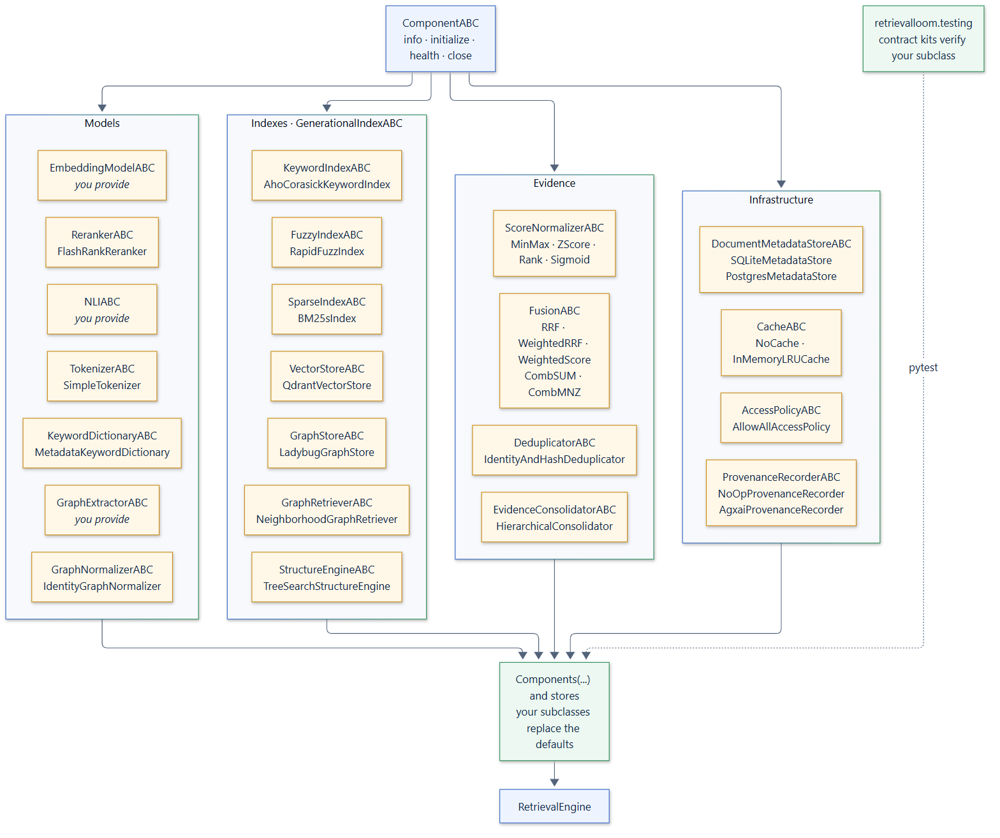

# Write your own backend

Connect the database, search service or model you already run. Every part of
the engine you can replace is defined by a small base class, called a
*contract*. Subclass it, pass an instance in `Components`, and the engine uses
it in place of the default. A ready-made test suite, the *contract kit*, then
checks that your implementation behaves the way the engine expects.

{ .diagram }

## Implement the base members

All contracts derive from `ComponentABC`
(`retrievalloom.contracts.component`):

| Member | Required | Purpose |
| --- | --- | --- |
| `info` | Yes | `ComponentInfo` with a fingerprint. Build it with `make_info(component=, implementation=, version=, config=, model_identity=, dimensions=)`. |
| `initialize(context)` | No | Called once when the engine opens. `context` holds the `offloader`, `clock`, `logger`, `metrics`, `data_dir` and `metadata_store`. |
| `close()` | No | Release resources the component created. Never close resources the application passed to it. |
| `health()` | No | Return a `HealthReport`. Default: healthy. |

`initialize` and `close` must be idempotent.

The fingerprint tells the engine when an index must be rebuilt: the engine
stores it with each generation and treats a generation built with a different
fingerprint as stale. Put every setting that changes the index content into `config` (or
`model_identity`/`dimensions`).

Pick the contract for the part you want to replace:

| `Components` field | Contract | Module | Contract kit |
| --- | --- | --- | --- |
| `metadata_store` | `DocumentMetadataStoreABC` | `retrievalloom.storage.base` | `MetadataStoreContract` |
| `embedding` | `EmbeddingModelABC` | `retrievalloom.contracts.models` | `EmbeddingModelContract` |
| `reranker` | `RerankerABC` | `retrievalloom.contracts.models` | `RerankerContract` |
| `nli` | `NLIABC` | `retrievalloom.contracts.models` | `NLIContract` |
| `tokenizer` | `TokenizerABC` | `retrievalloom.contracts.models` | - |
| `keyword_dictionary` | `KeywordDictionaryABC` | `retrievalloom.contracts.models` | - |
| `graph_extractor` | `GraphExtractorABC` | `retrievalloom.contracts.models` | `GraphExtractorContract` |
| `graph_normalizer` | `GraphNormalizerABC` | `retrievalloom.contracts.models` | - |
| `keyword_index` | `KeywordIndexABC` | `retrievalloom.contracts.indexes` | `KeywordIndexContract` |
| `fuzzy_index` | `FuzzyIndexABC` | `retrievalloom.contracts.indexes` | `FuzzyIndexContract` |
| `sparse_index` | `SparseIndexABC` | `retrievalloom.contracts.indexes` | `SparseIndexContract` |
| `vector_store` | `VectorStoreABC` | `retrievalloom.contracts.indexes` | `VectorStoreContract` |
| `graph_store` | `GraphStoreABC` | `retrievalloom.contracts.indexes` | `GraphStoreContract` |
| `graph_retriever` | `GraphRetrieverABC` | `retrievalloom.contracts.indexes` | - |
| `structure_engine` | `StructureEngineABC` | `retrievalloom.contracts.indexes` | `StructureEngineContract` |
| `method_fusion`, `channel_fusion` | `FusionABC` | `retrievalloom.contracts.evidence` | `FusionContract` |
| `deduplicator` | `DeduplicatorABC` | `retrievalloom.contracts.evidence` | `DeduplicatorContract` |
| `consolidator` | `EvidenceConsolidatorABC` | `retrievalloom.contracts.evidence` | `EvidenceConsolidatorContract` |
| `cache` | `CacheABC` | `retrievalloom.contracts.infra` | `CacheContract` |
| `access_policy` | `AccessPolicyABC` | `retrievalloom.contracts.infra` | - |
| `provenance_recorder` | `ProvenanceRecorderABC` | `retrievalloom.contracts.infra` | - |

`ScoreNormalizerABC` (with `ScoreNormalizerContract`) is the contract of the
normalizer you can pass to the score-based fusion classes in
`retrievalloom.evidence.fusion` (for example
`WeightedScoreFusion(normalizer=...)`). The [API reference](../../api/contracts.md)
documents every method.

## Implement an index backend

Index backends implement `GenerationalIndexABC` plus a channel-specific
`search`. You do not need to handle consistency yourself: the engine creates a
generation, writes items, seals it, and switches to it, so searches never read
a half-written index.

| Method | Obligation |
| --- | --- |
| `capabilities` | `IndexCapabilities(mutable_in_place, durable, filter_pushdown=True, max_batch=256)` |
| `create_generation(scope, spec)` | Create an empty generation. Idempotent. |
| `write(scope, generation_id, items)` | Write or overwrite items by `object_id`. |
| `remove(scope, generation_id, object_ids)` | Remove items; return how many were present. Always accepted. |
| `update_metadata(scope, generation_id, updates)` | Replace the filter metadata of existing items. |
| `seal(scope, generation_id)` | Finish the build; return `GenerationStats`. |
| `drop_generation(scope, generation_id)` | Delete a generation. Idempotent. |
| `list_generations(scope)` | Generations present in the backend for the scope. |

All methods are idempotent by `(generation_id, object_id)` and must reject data
of another scope.

- `mutable_in_place=True` lets the lifecycle write into the active generation
  (incremental updates). With `False`, every change builds a new generation,
  and `write` is accepted only before `seal`. Keyword and fuzzy units still
  get a new generation when the keyword dictionary changes, because
  `GenerationSpec.keyword_entries` is fixed per generation.
- `durable=True` declares that data outlives the process and may be shared
  between engines. The engine then protects generations with durable reader
  leases (see [Run several engines on one store](multiple-engines.md)).
- `filter_pushdown=False` makes the engine filter after the search and report
  `filter_post_applied`.

Run blocking client calls through `context.offloader` (see
[Offloading and admission](../concepts/offloading.md)).

## Check it with a contract kit

`retrievalloom.testing` ships pytest contract kits. They need the `testing`
extra:

```bash
pip install "retrievalloom[testing]"
```

Subclass the kit in a `Test*` class and implement `make_component`. pytest
collects and runs every inherited check against your component, initialized
with a real `ComponentContext` and closed afterwards:

```python
# tests/test_my_embedding.py
from pathlib import Path

from retrievalloom.testing import EmbeddingModelContract

from my_app.embedding import HashEmbedding


class TestHashEmbedding(EmbeddingModelContract):
    async def make_component(self, tmp_path: Path) -> HashEmbedding:
        return HashEmbedding()
```

The kits are async tests. Run them with pytest-asyncio in auto mode:

```toml
[tool.pytest.ini_options]
asyncio_mode = "auto"
```

Optional hooks:

| Hook or attribute | Purpose |
| --- | --- |
| `prepare(component)` | Bring the initialized component into a usable state. `MetadataStoreContract` migrates the schema here. |
| `resource_manager()` | Return a started resourcera `ResourceManager` to share between tests. Default: one per test. |
| `EmbeddingModelContract.tolerance` | Absolute tolerance when comparing repeated embeddings (default `1e-4`). |
| `RerankerContract.check_relevance` | Also require that the relevant passage scores highest (default `True`). |
| `NLIContract.check_semantics` | Also require the obvious entailment and contradiction labels (default `True`). |
| `FusionContract.reference(lists, weights)` | Abstract: the expected fused scores for your formula. |

Every kit also checks that `info` is stable, that `health()` names the
component, and that `initialize` and `close` are idempotent.

RetrievalLoom runs its own built-in backends against the same kits in
`tests/contracts/`.

## Next steps

- Copy complete adapters for FlagEmbedding, sentence-transformers and others
  from [Custom components](../../examples/adapters.md).
- See every contract method in the [API reference](../../api/contracts.md).
- Let a coding agent write the adapter with the
  [`retrievalloom-extend` skill](../../agent-skills/index.md).
