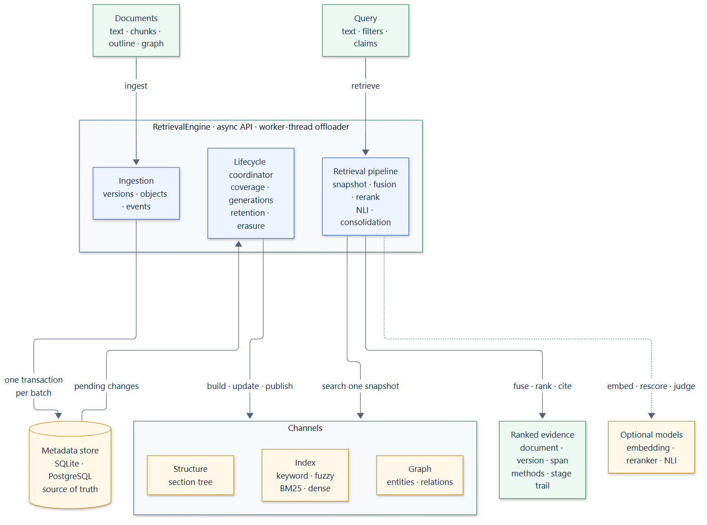

---
hide:
  - navigation
  - toc
---

<div class="rl-hero" markdown>

# RetrievalLoom

<p class="rl-tagline">Hybrid search for async Python applications. Find the
right passage whether the user types an exact code, a typo or a paraphrase, and
see exactly which document version it came from.</p>

[Get started](getting-started/index.md){ .md-button .md-button--primary }
[Quickstart](getting-started/quickstart.md){ .md-button }
[API reference](api/index.md){ .md-button }

</div>

## Why RetrievalLoom

A support assistant has to answer "What does error `E1042` mean?", "How do I
fix a conflcted copy?" and "How do I get my money back?" in the same hour. The
first needs exact matching, the second tolerates a typo, and the third shares no
words with the article that answers it. RetrievalLoom runs all of these searches
in one call and merges them into one ranked list.

It runs inside your application, so there is no service to deploy. You bring
the documents, and optionally your own models and stores. RetrievalLoom keeps
the indexes current as documents change, isolates your customers from each
other, and records where every result came from.

<div class="grid cards" markdown>

-   :material-source-merge:{ .lg .middle } **Every kind of match**

    ---

    Keyword, typo-tolerant, BM25 and semantic search run together. Graph and
    section-tree search can join the same ranked list.

-   :material-file-certificate-outline:{ .lg .middle } **Results you can cite**

    ---

    Each result names its document, version and the methods that found it, plus
    the span, pages and section path you supplied.

-   :material-sync:{ .lg .middle } **Always-current indexes**

    ---

    Edits and deletions reach every index. Searches never mix document versions
    or read a half-built index, even while a model change is rebuilt.

-   :material-account-group-outline:{ .lg .middle } **Built for many customers**

    ---

    Every call is scoped to a tenant and collection, with per-tenant limits and
    an access policy hook for your own rules.

-   :material-timer-sand:{ .lg .middle } **A responsive event loop**

    ---

    Model inference and index work run in worker threads with admission
    control, so your service keeps answering requests.

-   :material-puzzle-outline:{ .lg .middle } **Your own components**

    ---

    Swap in your own embedding model, reranker, vector store or metadata store
    by subclassing a small base class. Contract kits test it for you.

</div>

    ## How it works

    Your application sends documents and queries. The engine stores every document
    version in the metadata store, keeps each channel's indexes in step with it,
    and answers a query by searching one consistent snapshot of every channel.

    { .diagram }

## Thirty-second tour

=== "pip"

    ```bash
    pip install retrievalloom
    ```

=== "uv"

    ```bash
    uv add retrievalloom
    ```

RetrievalLoom supports Python 3.12 to 3.14. Extras add knowledge-graph search
(`graph`), section-tree search (`structure`), PostgreSQL storage (`postgres`)
and the test kits for your own components (`testing`). See
[Installation](getting-started/installation.md).

The program below indexes three documents in memory and searches them. It needs
no model, server or network access:

```python
import asyncio

from retrievalloom import (
    DocumentInput,
    RetrievalEngine,
    Scope,
    SourceDescriptor,
    TextRepresentation,
)

TEXTS = {
    "asyncio": "asyncio runs coroutines on a single-threaded event loop.",
    "bm25": "BM25 ranks documents by term frequency and inverse document frequency.",
    "eiffel": "The Eiffel Tower in Paris was completed in 1889.",
}


async def main() -> None:
    scope = Scope(tenant_id="acme")
    documents = [
        DocumentInput(
            id=key,
            source=SourceDescriptor(uri=f"kb://{key}"),
            representations=[TextRepresentation(text=text)],
        )
        for key, text in TEXTS.items()
    ]
    async with RetrievalEngine() as engine:
        await engine.ingest(documents, scope=scope)
        result = await engine.retrieve("event loop coroutines", scope=scope, top_k=3)
        for item in result.evidence:
            source = item.sources[0]
            methods = sorted({hit.method.key for hit in item.provenance.hits})
            print(f"{source.document_id} v{source.document_version} {item.score:.4f} {methods}")


asyncio.run(main())
```

Output:

```text
asyncio v1 0.0164 ['index.fuzzy', 'index.sparse']
```

Each result names the document version it came from and the search methods
that found it. The [Quickstart](getting-started/quickstart.md) walks
through the same program step by step.

## Let your coding agent integrate it

The [RetrievalLoom Agent Skills](agent-skills/index.md) teach a coding agent the
workflow and rules for adding RetrievalLoom to an application, and for extending
it with your own models, stores and pipeline stages.

## Where to go next

<div class="grid cards" markdown>

-   :material-rocket-launch:{ .lg .middle } __[Quickstart](getting-started/quickstart.md)__

    ---

    Ingest documents, retrieve evidence and read its provenance.

-   :material-book-open-variant:{ .lg .middle } __[User guide](guide/index.md)__

    ---

    Scopes, channels, generations and evidence, and how-to guides for common
    tasks.

-   :material-connection:{ .lg .middle } __[Integrations](integrations/index.md)__

    ---

    Qdrant, resourcera, refresh-engine, agxai, LadybugDB and TreeSearch.

-   :material-code-braces:{ .lg .middle } __[Examples](examples/index.md)__

    ---

    Runnable scenarios, from an in-memory quickstart to Qdrant with real
    models, with their expected output.

-   :material-speedometer:{ .lg .middle } __[Benchmarks](benchmarks.md)__

    ---

    Measured ingestion and retrieval latency, and how to reproduce it.

-   :material-api:{ .lg .middle } __[API reference](api/index.md)__

    ---

    Every public class and method, generated from the source.

</div>
